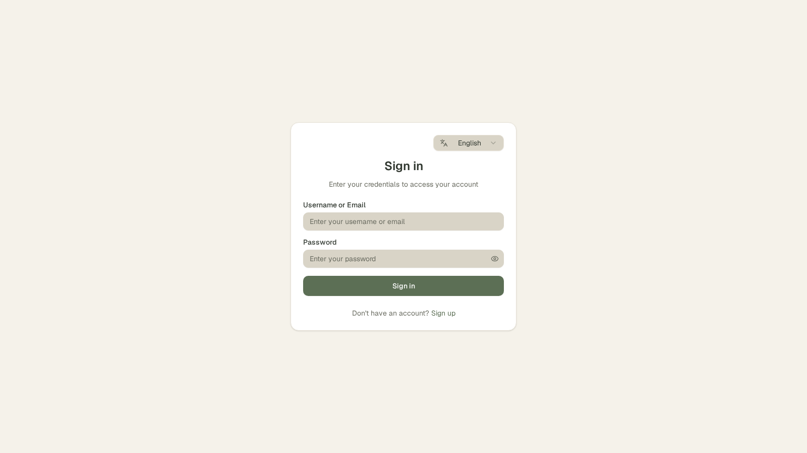
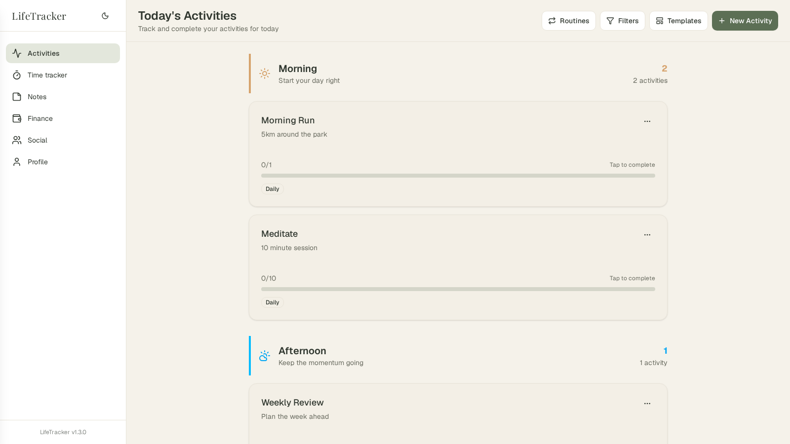
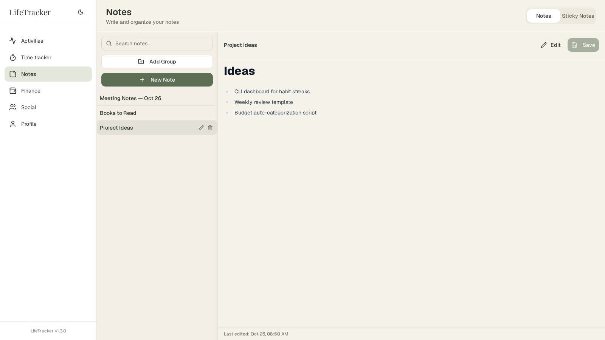
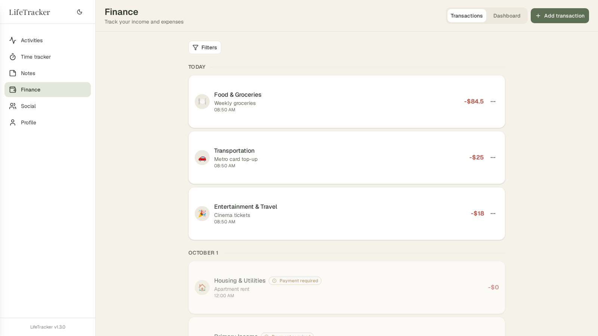
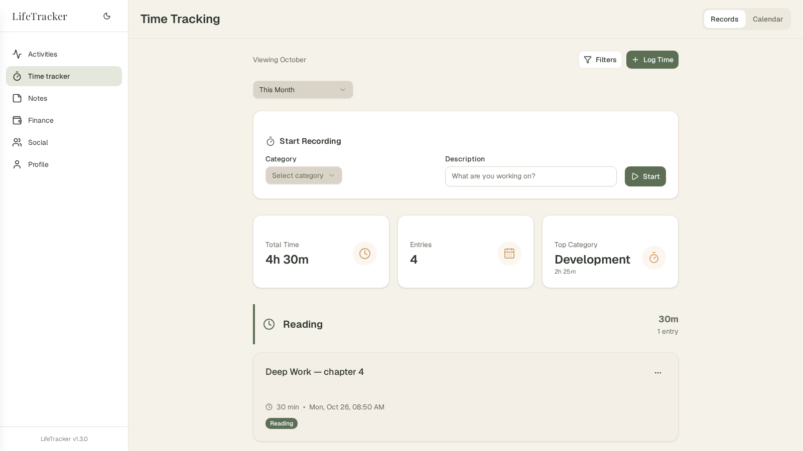
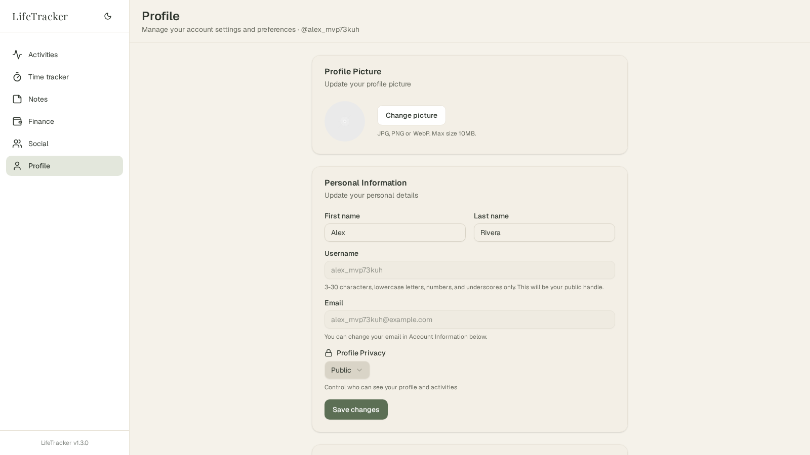

# Life Tracker

A personal life-tracking platform covering **habits & activities**, **finances**, **notes**, and **time tracking**. This repository is a monorepo that consolidates the previous separate projects (`life-tracker-backend`, `life-tracker-frontend`, `life-tracker-extension`) into a single codebase.

## Quick Start

```bash
make setup   # copies .env.example → .env
make dev     # API :8080 (air hot-reload) + web :3000 + postgres + mongodb
make stop    # stop the stack (required before switching run modes)
```

Run `make` (or `make help`) for the main commands and see [`docs/getting-started.md`](./docs/getting-started.md) for details on all three run modes.

---

## App Images

| Login | Activities | Notes |
|:-:|:-:|:-:|
|  |  |  |
| **Finance** | **Time Tracker** | **Profile** |
|  |  |  |

---

## Repository Structure

| Directory | Project | Stack | Purpose |
|---|---|---|---|
| [`backend/`](./docs/backend.md) | Life Tracker API | Go, Gin, GORM, PostgreSQL, MongoDB, JWT | REST API with domain modules: auth, user, activity (habits), finance, note, time, routine, social |
| [`frontend/`](./docs/frontend.md) | Life Tracker Web App | Next.js, TypeScript, shadcn/ui | Web application for tracking activities, finances, time, notes, and profile |
| [`apps/mobile/`](./docs/mobile.md) | Life Tracker Mobile App | Expo, React Native, NativeWind | Android app sharing services, types, and i18n with the web app |
| [`packages/shared/`](./packages/shared/) | Shared packages | TypeScript | Code shared by web + mobile: services, types, lib, i18n |
| [`docker-compose.yml`](./docs/deployment-modes.md) · [`nginx/`](./nginx/) · [`scripts/`](./scripts/) | Deployment | docker compose, nginx | Single compose file for the whole stack (api + databases + web); profiles for observability and load testing |
| [`loadtest/`](./docs/loadtest.md) | Load testing | k6 (Docker), Prometheus remote write, Grafana | Stress tests: hundreds of req/s, multi-user scenarios, live dashboards |

### Conventions

- Each sub-project is fully self-contained (own dependencies, tests, Dockerfile).
- **Path-filtered CI**: workflows trigger only when files under their directory change (e.g., `backend/**`).
- The backend and frontend workflows push Docker images to Docker Hub using repository secrets (see [`docs/ci-cd.md`](./docs/ci-cd.md)).
- **All docker compose definitions live in the root `docker-compose.yml`** (observability and load-test stacks are compose *profiles*); the two nginx configs are in `nginx/` and the deploy/migrate scripts in `scripts/`. **Every make command lives in the root `Makefile`** — run `make` (or `make help`) from the repo root for the main commands (run modes, stop, tests), and `make components` for the full backend/frontend/databases/docker list.

---

## Documentation

All documentation lives in [`docs/`](./docs/). This root README covers only the monorepo architecture and shared concerns.

| Doc | Contents |
|---|---|
| [`docs/data-schemas.md`](./docs/data-schemas.md) | Domain data schemas with one diagram per domain (activities, finance, user, personal) |
| [`docs/getting-started.md`](./docs/getting-started.md) | Run modes from the repo root, how to start/stop the stack, per-project setup pointers |
| [`docs/deployment-modes.md`](./docs/deployment-modes.md) | The three deployment modes (`make dev`, `dev-container`, `dev-full`) with architecture diagrams |
| [`docs/architecture.md`](./docs/architecture.md) | Container architecture: services, request flow, observability and deployment |
| [`docs/ci-cd.md`](./docs/ci-cd.md) | GitHub Actions workflows (backend/frontend CI) and the required repository secrets |
| [`docs/tests.md`](./docs/tests.md) | Backend integration tests and k6 load testing with live Grafana monitoring |
| [`docs/mobile.md`](./docs/mobile.md) | Android app: building the APK (local Gradle build or EAS) and development |
| [`docs/backend.md`](./docs/backend.md) | Backend API: per-domain schemas, business logic, and the full HTTP API reference |
| [`docs/frontend.md`](./docs/frontend.md) | Web app: features, tech stack, setup, and build commands |
| [`docs/loadtest.md`](./docs/loadtest.md) | k6 load testing: test lanes, scenario matrix, live monitoring, cleanup |

---

## License

Per-project licensing applies (the backend is MIT-licensed; see `backend/LICENSE`).
