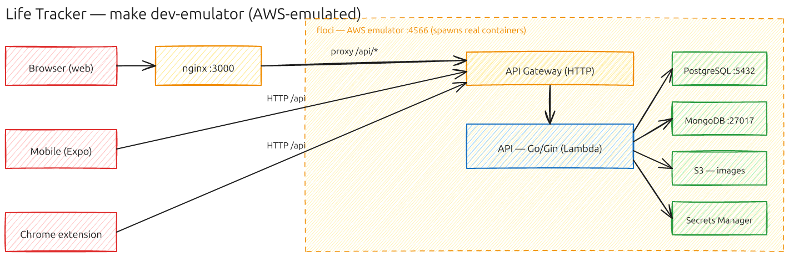
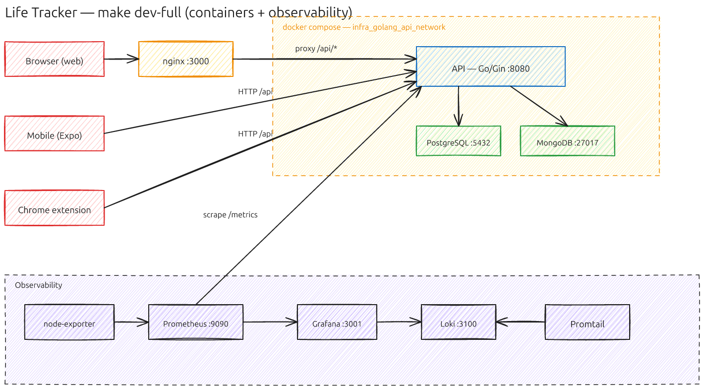

# Life Tracker

A personal life-tracking platform covering **habits & activities**, **finances**, **notes**, **time tracking**, and **screen time**. This repository is a monorepo that consolidates the previous separate projects (`life-tracker-backend`, `life-tracker-frontend`, `life-tracker-extension`) into a single codebase.

---

## Deployment Modes

The stack runs in three modes, one diagram each. All three are started from the repository root (`make dev`, `make dev-emulator`, `make dev-full`) and stopped with `make stop`; see [Getting Started](#getting-started) for details.

### 1. `make dev` — container mode


Everything is a plain Docker container on a single compose network (`infra_golang_api_network`): the Go API (`:8080`), PostgreSQL (`:5432`), MongoDB (`:27017`), and the frontend. nginx serves the static Next.js export on `:3000` and proxies `/api/*` to the API container, so the browser talks same-origin and CORS never enters the picture. The mobile app and Chrome extension bypass nginx and hit the API directly on `:8080`. Migrations run once at startup from a one-shot container inside the network.

No floci, no AWS emulation — this is the classic "compose up" deployment and the fastest loop for day-to-day backend/frontend development.

### 2. `make dev-emulator` — AWS-emulated mode



[floci](#architecture-aws-shaped-emulated-locally-with-floci) (an AWS emulator, `floci/floci:1.6.0-compat`) emulates AWS on `:4566` and spawns real containers for each emulated service. The API is built and deployed as a **Lambda behind an emulated API Gateway** (HTTP API, stage `dev`) — the same deploy artifacts and request path as production. nginx still fronts the app on `:3000`, but now proxies `/api/*` to the gateway instead of an API container; the mobile app and extension can target the gateway directly. Data lives in the emulated RDS (PostgreSQL), DocumentDB (MongoDB), S3 (images), and Secrets Manager (config).

This is a rehearsal of the real AWS topology: if `make dev-emulator` is green, `terraform apply` against a real AWS account deploys the same shape. The Lambda runs inside the emulator's network because the emulated databases are only reachable from there (see `infra/scripts/migrate.sh`).

### 3. `make dev-full` — container mode + observability



Identical to container mode, plus the `observability` compose profile: Prometheus (`:9090`) scrapes the API's `/metrics` endpoint and node-exporter; Grafana (`:3001`) dashboards over Prometheus metrics and Loki logs; Promtail ships container logs into Loki (`:3100`). Use it when you want metrics, logs, and dashboards locally — typically while running the k6 load tests in [`loadtest/`](./loadtest/).

_Sources: [`docs/architecture-dev.excalidraw`](./docs/architecture-dev.excalidraw), [`docs/architecture-dev-emulator.excalidraw`](./docs/architecture-dev-emulator.excalidraw), [`docs/architecture-dev-full.excalidraw`](./docs/architecture-dev-full.excalidraw)._

---

## Repository Structure

| Directory | Project | Stack | Purpose |
|---|---|---|---|
| [`backend/`](./backend/README.md) | Life Tracker API | Go, Gin, GORM, PostgreSQL, MongoDB, JWT | REST API with domain modules: auth, user, activity (habits), finance, note, time, routine, social, screentime |
| [`frontend/`](./frontend/README.md) | Life Tracker Web App | Next.js, TypeScript, shadcn/ui | Web application for tracking activities, finances, time, notes, and profile |
| [`chrome-extension/`](./chrome-extension/README.md) | Life Tracker Screen Time Extension | JavaScript, Manifest V3 | Chrome extension that records visits to configured sites into the backend |
| [`infra/`](./infra/) | Infrastructure | docker compose, floci (AWS emulator) | All compose definitions and commands for running the stack locally |
| [`loadtest/`](./loadtest/) | Load testing | k6 (Docker), Prometheus remote write, Grafana | Stress tests: hundreds of req/s, multi-user scenarios, live dashboards |

Each project has its own `README.md` with detailed documentation. This root README covers only the monorepo architecture and shared concerns.

---

## Monorepo Layout

```
.
├── .github/workflows/     # CI/CD (root-level, GitHub Actions only detects workflows here)
│   ├── backend-ci.yml     # Backend tests + floci Lambda deploy smoke
│   └── frontend-ci.yml    # Frontend static export + Docker image build/push
├── backend/               # Go REST API
├── frontend/              # Next.js web application
├── infra/                 # All docker compose files + scripts (docker/floci tooling)
├── loadtest/              # k6 load/stress tests + live monitoring setup
├── chrome-extension/      # Chrome MV3 extension
└── README.md
```

### Conventions

- Each sub-project is fully self-contained (own dependencies, tests, Dockerfile).
- **Path-filtered CI**: workflows trigger only when files under their directory change (e.g., `backend/**`).
- The backend and frontend workflows push Docker images to Docker Hub using repository secrets (see below).
- **All docker compose definitions live in `infra/`** (`infra/docker-compose*.yml`, `infra/scripts/`). **Every make command lives in the root `Makefile`** — run `make` (or `make help`) from the repo root for the main commands (run modes, stop, tests), and `make components` for the full backend/frontend/databases/infra list.

---

## Architecture (AWS-shaped, emulated locally with floci)

The application is architected against AWS managed services rather than bare Docker containers: the API runs as a **Lambda function behind API Gateway v2**, data lives in **RDS PostgreSQL** and **DocumentDB**, user images and the frontend artifact live in **S3**, and the JWT signing key comes from **Secrets Manager**. Locally, **floci** (an AWS emulator, `floci/floci:1.6.0-compat`) stands in for AWS so the exact same deployment path runs on a developer machine.

floci runs as a container with the **Docker socket mounted**, which lets it spawn *real* containers for the data services and the Lambda — not mocks. Everything floci creates shares the emulator's docker network (`infra_golang_api_network`). This is also why the API cannot run as a host process: the provisioned databases are only reachable from inside that network (see `infra/scripts/migrate.sh`).

### Service mapping

| AWS service | Local equivalent | Role |
|---|---|---|
| AWS Lambda | Go binary (`bootstrap`, runtime `provided.al2`, `APP_RUNTIME=serverless`) uploaded by `floci-deploy` | The REST API (Gin) |
| API Gateway v2 | HTTP API pinned as `lifetracker-api`, stage `dev`, route `ANY /{proxy+}` | Public entrypoint for `/api/*` |
| RDS PostgreSQL | Real `postgres:16-alpine` container (`lifetracker-postgres`) spawned by floci | Relational data: users, activities, notes, time, routines, social |
| DocumentDB | Real `mongo:7.0` container (`lifetracker-docdb`) spawned by floci | Document data: activity records, transactions, payments, screen time |
| S3 | Buckets `lifetracker-images` (user images) and `lifetracker-web` (frontend artifact) | Object storage |
| Secrets Manager | Secret `life-tracker/jwt-secret` | JWT signing key |
| CloudFront | nginx container `lifetracker-web` on :3000 | Serves the static frontend export |

> floci's CloudFront data-plane has parity gaps, so the local stand-in for CloudFront is an nginx container. The S3 `lifetracker-web` bucket remains the deploy artifact: CI asserts the export is produced and `deploy-frontend.sh` syncs it there.

### Request flow

```
Browser
  │
  ▼  http://localhost:3000
nginx (lifetracker-web) ── serves the Next.js static export
  │
  └─ /api/*  →  floci API Gateway        (same-origin proxy, no CORS preflights)
                 │
                 ▼  /execute-api/lifetracker-api/dev/api/*
              Lambda (Gin API, APP_RUNTIME=serverless)
                 │
                 ▼
              RDS PostgreSQL + DocumentDB + S3 + Secrets Manager
              (all on the emulator network)
```

The nginx proxy keeps API calls same-origin because floci's gateway does not answer CORS preflights — cross-origin browser calls would fail. Migrations run at provision time (not per Lambda cold start) via `infra/scripts/migrate.sh`, which executes the migrate binary inside a container on the emulator network.

### Provisioning & deployment

- `infra/scripts/provision.sh` — idempotent. Creates the S3 buckets, Secrets Manager secret, RDS instance, and DocumentDB cluster, then writes `infra/.floci.env` (machine-specific endpoints; gitignored).
- `infra/scripts/deploy-lambda.sh` — runs migrations, builds the Go Lambda, and creates/updates the function plus the API Gateway route.
- `infra/scripts/deploy-frontend.sh` — `next build` (static export), bakes the runtime `env-config.js`, syncs to S3, and copies the output into the nginx volume.

`make dev-emulator` (repo root) runs all three against the current source, so re-running it is the "restart with the latest code" command.

---

## CI/CD

GitHub Actions workflows live in `.github/workflows/` at the **repository root** (GitHub only auto-discovers workflows there — workflows nested inside sub-projects are ignored).

### `backend-ci.yml`

- **`test` job**: runs on pushes/PRs touching `backend/**`. Starts the floci AWS emulator (Docker socket required), provisions S3/RDS/DocumentDB/Secrets Manager via `infra/scripts/provision.sh`, runs the integration test suite against the floci services, then deploys the API as a Lambda behind API Gateway v2 (`make floci-deploy`) and smoke-tests `/health` through the gateway. Go 1.24.
- **`build-push` job**: after tests pass, on `main` pushes only — builds and pushes the backend image to Docker Hub (`*DOCKERHUB_USERNAME*/lifetracker-backend`), and uploads Postman endpoint collections as an artifact.

### `frontend-ci.yml`

- **`build-export` job**: runs on pushes/PRs touching `frontend/**`. Installs dependencies and runs `next build` with `output: 'export'`, asserting `out/index.html` is produced.
- **`build-and-push` job**: builds and pushes the frontend image to Docker Hub (`lautaroblasco1998/lifetracker-frontend`). On PRs it builds without pushing.

---

## Testing

### Backend tests

The Go test suite (testify + httptest) runs against isolated Docker databases. From the repo root:

| Command | What it does |
|---|---|
| `make test` | Starts test DBs (`docker-compose.db.yml`), runs `gotestsum -race`, stops DBs |
| `make test-only` | Runs the suite against already-running test DBs |
| `make code-check` | Format + lint (`golangci-lint`) |
| `make db-test-up` / `make db-test-down` | Manage the test databases manually |

`make test-floci` runs the suite against the floci-provisioned services instead of the compose test DBs (the path CI uses).

### Load testing (k6)

Stress tests live in [`loadtest/`](./loadtest/) — k6 scenarios that fire hundreds of requests per second across hundreds of users at different rhythms, with **live metrics in Grafana while a test runs**. k6 runs in Docker, so no local install is needed.

**Test lanes** — the same scripts target any lane via `BASE_URL`:

| Lane | Target | Default URL |
|---|---|---|
| Backend direct | compose `api` container | `http://localhost:8080` |
| Full stack | nginx frontend proxy (`make loadtest-fe-up`) | `http://localhost:3000` |
| Static assets | nginx static export (frontend serving) | `http://localhost:3000` |
| floci gateway (optional) | emulated Lambda | `http://localhost:4566/execute-api/lifetracker-api/dev` |

**One command — the full suite**:

```bash
make loadtest                  # stack up -> provision users -> smoke -> read/write/auth/mixed
                               # -> features (full API coverage) -> cleanup.
                               # Watch Grafana (:3001) while it runs.
```

Overrides propagate to every step: `make loadtest USERS=500 RATE=600 DURATION=2m` (full list in [`loadtest/README.md`](./loadtest/README.md)). Skip the final user cleanup with `CLEANUP=0`.

**Advanced runs** (fine-tuning / specialized):

```bash
make loadtest-breakpoint       # ramp VUs until the app collapses
make loadtest-soak SOAK_RATE=200 SOAK_DURATION=30m
make loadtest-static           # frontend serving lane (needs fe-up)
make loadtest-tap              # live API responses in the terminal
make loadtest-provision USERS=500   # just create users
make loadtest-cleanup          # just delete test users
```

Every scenario streams its metrics live to Prometheus and stops on error-rate/p95 thresholds. Key overrides: `USERS`, `PREFIX`, `RATE`, `DURATION`, `BASE_URL`, `MAX_VUS`, `SOAK_*`, `LOGIN_RATE` (full table in [`loadtest/README.md`](./loadtest/README.md)).

**Live monitoring** — k6 pushes metrics to the compose Prometheus every 1s (remote write), so Grafana (`http://localhost:3001`, default `admin/admin`) shows the load side and the app side while a test runs:

- **Load Test** dashboard — merged view: VUs, req/s, error rate, p50/p95/p99, checks, plus app latency/errors by endpoint, DB connections, host CPU/mem.
- **k6 Prometheus (Native Histograms)** — official Grafana k6 dashboard.
- Existing per-domain dashboards (Activities, Finance, Notes, Time, Users & Auth, Nginx).

```bash
make loadtest-stack-up                 # Prometheus + Grafana included
make loadtest-read-heavy RATE=600 DURATION=2m   # watch it live on :3001
make loadtest-tap                      # raw API responses in the terminal
make loadtest-tap TAP_PATH=/api/notes TAP_INTERVAL=2   # time | status | latency | body
```

Notes: disable live streaming with `REMOTE_WRITE=0`; the floci/Lambda path is not scraped (separate docker network), so dashboards cover the compose lane. The load-test stack is self-contained (`infra/docker-compose.loadtest.yml` — pinned credentials, its own volumes), so it works regardless of `backend/.env` and never touches dev DB data or floci. Prometheus runs with remote-write receiver + native histograms enabled (`infra/docker-compose.yml`), and app metrics are scraped every 5s (`backend/monitoring/prometheus.yml`). Dashboards are provisioned automatically from `backend/monitoring/grafana/provisioning/dashboards/`.

---

## Repository Secrets

The workflows rely on Docker Hub credentials. Configure these in **Settings → Secrets and variables → Actions** of the `life-tracker` repository:

| Secret | Required by | Purpose |
|---|---|---|
| `DOCKERHUB_USERNAME` | backend-ci.yml, frontend-ci.yml | Docker Hub account used in image names and for login |
| `DOCKERHUB_TOKEN` | backend-ci.yml, frontend-ci.yml | Docker Hub access token for image push authentication |

> Note: secrets are per-repository and **do not** transfer from the old separate repos (`life-tracker-backend`, etc.). They must be added manually to this repo.

---

## Getting Started

Each project is self-contained; see its README for setup.

Three run modes from the repository root (one at a time; `make stop` stops whichever is running):

| Command | Mode | What runs | URLs |
|---|---|---|---|
| `make dev` | Container | API container + postgres + mongodb + frontend (nginx proxies `/api` → `:8080`). No floci, no observability. | API `:8080/api`, app `:3000` |
| `make dev-emulator` | AWS-emulated | floci + provisioned RDS/DocumentDB + API as a Lambda behind API Gateway v2 + frontend (nginx proxies `/api` → gateway). This is the pre-deploy test of the real-AWS path. | Gateway `:4566/execute-api/lifetracker-api/dev/`, app `:3000` |
| `make dev-full` | Container + observability | Same as `make dev` plus Prometheus, Grafana, Loki, Promtail, node-exporter. | + Prometheus `:9090`, Grafana `:3001`, Loki `:3100` |

All three are idempotent — re-running a mode's command redeploys the backend and frontend with the latest code, so it doubles as the restart command.

- `make stop` tears down everything (compose down ignores profiles, so it removes every running service of the project, including floci, observability, and the frontend container).
- Note: in emulator mode the API runs as a Lambda because the floci-provisioned databases are only reachable from the emulator's docker network (see `infra/scripts/migrate.sh`). The legacy Postgres/Mongo compose path (`docker-compose.db.yml`) is optional rollback tooling; CI and `make dev-emulator` do not use it.
- **Backend**: [`backend/README.md`](./backend/README.md) — `make backend-dev` runs the API with databases (air hot reload). For the AWS-shaped path: `make floci-up` / `floci-provision` / `floci-dev` / `floci-deploy`.
- **Infrastructure**: the root `Makefile` (`make help`) owns every docker compose command. Compose files: `docker-compose.yml` (all services; floci and the monitoring stack are compose *profiles* — `emulator` and `observability` — so the plain `dev` lanes never start them), `docker-compose.db.yml` (legacy DBs), `docker-compose.frontend.yml` (frontend container; the `.override` variant points nginx at the API container instead of the gateway).
- **Frontend**: [`frontend/README.md`](./frontend/README.md) — install dependencies and run the Next.js dev server. The static export is served at `http://localhost:3000` via `make frontend-up` (nginx; the local stand-in for CloudFront, since floci's CloudFront data-plane has parity gaps) and synced to S3 as a deploy artifact via `make deploy-frontend` (set `DEPLOY_S3=0` to skip the S3/CloudFront steps in container mode — the `make dev` lanes do this automatically).
- **Chrome Extension**: [`chrome-extension/README.md`](./chrome-extension/README.md) — load as an unpacked extension pointing at a local backend.

---

## Mobile App (Android)

The Android app lives in [`apps/mobile/`](./apps/mobile/) and shares business logic (services, types, i18n) with the web frontend via [`packages/shared/`](./packages/shared/). Stack: Expo SDK 57, React Native, expo-router, NativeWind.

### Building the APK

**EAS cloud build** (recommended — no local Android toolchain needed):

```bash
cd apps/mobile
npx eas-cli login                  # Expo account (create one at expo.dev)
npx eas-cli build --platform android --profile preview
```

The `preview` profile produces an APK for internal distribution. When the build finishes (~15–25 min) you get a QR code + URL to install directly on a device.

> If you prefer a global install over `npx`, run `npm config set prefix ~/.npm-global && export PATH="$HOME/.npm-global/bin:$PATH"` once, then `npm install -g eas-cli`.

**Local build** (requires Android SDK + JDK 17):

```bash
cd apps/mobile
npx eas build --platform android --profile preview --local
```

**Development** (debug build on a connected device/emulator):

```bash
cd apps/mobile
npx expo run:android
```

---

## License

Per-project licensing applies (the backend is MIT-licensed; see `backend/LICENSE`).
