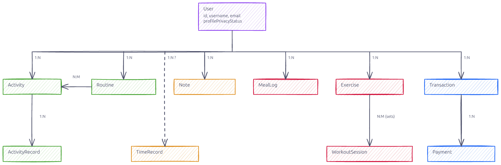
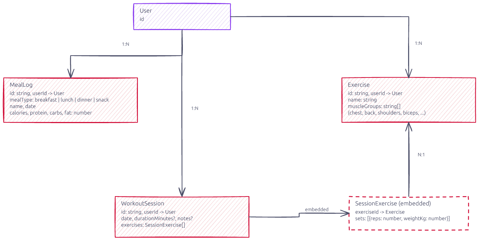

# Data Schemas

Entities and relationships from [`packages/shared/src/types/`](../packages/shared/src/types/) — one excalidraw diagram per domain.

## Overview

## Activities & routines

## Finance

## Health

## User & social

## Personal

