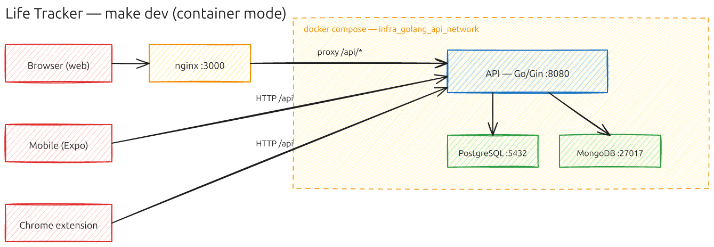

# Deployment Modes

The stack runs in four modes, one diagram each. All are started from the repository root (`make dev`, `make dev-container`, `make dev-emulator`, `make dev-full`) and stopped with `make stop`; see [Getting Started](./getting-started.md) for details.

## 1. `make dev` — fast lane (host-run, hot reload)

`next dev` serves the app on `:3000` with HMR and the API hot-reloads on the host with air (`:8080`), so a save is live in seconds — no image rebuild, no static export. Only the databases run in compose (`:5432`, `:27017`); the frontend talks to the API directly and the backend's CORS middleware allows it in dev. Migrations run from the API on every (re)start. Ctrl-C stops air and the frontend; the databases stay up until `make stop` / `make db-down`.

Use this for the daily edit loop. It does not exercise the prod Dockerfile, the static export, or the nginx proxy — that's what the container lane is for.

## 2. `make dev-container` — container mode

Everything is a plain Docker container on a single compose network (`infra_golang_api_network`): the Go API (`:8080`), PostgreSQL (`:5432`), MongoDB (`:27017`), and the frontend. nginx serves the static Next.js export on `:3000` and proxies `/api/*` to the API container, so the browser talks same-origin and CORS never enters the picture. The mobile app and Chrome extension bypass nginx and hit the API directly on `:8080`. Migrations run once at startup from a one-shot container inside the network.

No floci, no AWS emulation — this is the classic "compose up" deployment and the parity check that the prod-built image and export still work. Re-run it after changes (nothing watches files here).

## 3. `make dev-emulator` — AWS-emulated mode

[floci](./architecture.md#architecture-aws-shaped-emulated-locally-with-floci) (an AWS emulator, `floci/floci:1.6.0-compat`) emulates AWS on `:4566` and spawns real containers for each emulated service. The API is built and deployed as a **Lambda behind an emulated API Gateway** (HTTP API, stage `dev`) — the same deploy artifacts and request path as production. nginx still fronts the app on `:3000`, but now proxies `/api/*` to the gateway instead of an API container; the mobile app and extension can target the gateway directly. Data lives in the emulated RDS (PostgreSQL), DocumentDB (MongoDB), S3 (images), and Secrets Manager (config).

This is a rehearsal of the real AWS topology: if `make dev-emulator` is green, `terraform apply` against a real AWS account deploys the same shape. The Lambda runs inside the emulator's network because the emulated databases are only reachable from there (see `infra/scripts/migrate.sh`).

## 4. `make dev-full` — container mode + observability

Identical to container mode, plus the `observability` compose profile: Prometheus (`:9090`) scrapes the API's `/metrics` endpoint and node-exporter; Grafana (`:3001`) dashboards over Prometheus metrics and Loki logs; Promtail ships container logs into Loki (`:3100`). Use it when you want metrics, logs, and dashboards locally — typically while running the k6 load tests in [`loadtest/`](../loadtest/).

_Diagrams authored in Excalidraw._
